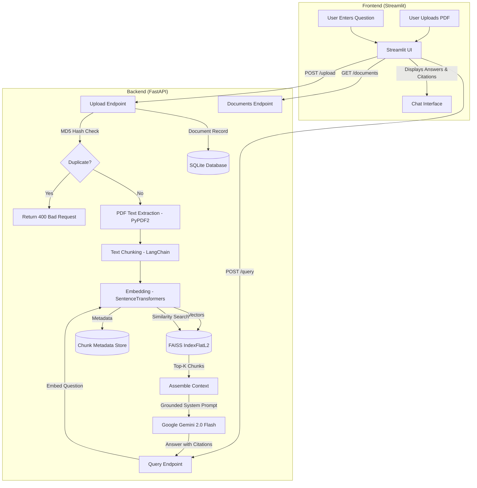

# IntelliDoc 📄🤖

> **AI-Powered Document Q&A Platform using Retrieval-Augmented Generation (RAG)**

IntelliDoc is a high-performance, production-ready document question-answering platform. It allows users to upload PDF documents, intelligently chunks and embeds them into a dense vector space, indexes them using FAISS for low-latency similarity search, and queries Google Gemini (`gemini-2.0-flash`) with retrieved document passages to provide factually grounded answers with source citations.

---

## 🏛️ Architecture Overview



---

## ✨ Features

- **Document Ingestion & Deduplication**: Fast text extraction from PDF pages with MD5 checksum verification to prevent duplicate storage.
- **Context-Preserving Recursive Chunking**: Splits large documents into overlapping text segments while preserving page numbers and document provenance.
- **Dense Vector Search**: Powered by `sentence-transformers` (`all-MiniLM-L6-v2`) and local `FAISS` (`IndexFlatL2`) similarity search.
- **LLM Grounding & Factuality**: Leverages Google Gemini (`gemini-2.0-flash`) instructed with strict context adherence to prevent hallucinations.
- **Transparent Citations**: Every generated response includes reference passages, source file names, page numbers, and vector distance metrics.
- **Interactive Web Interface**: Streamlit UI with document management, responsive chat conversation history, and real-time backend health monitoring.
- **RESTful API**: Standardized FastAPI endpoints with automatic OpenAPI documentation (`/docs` and `/redoc`).
- **Resilient & Graceful Fallbacks**: Operates seamlessly even if LLM keys are absent by providing retrieved context directly to the user.

---

## 🛠️ Tech Stack

| Component | Technology | Description |
| :--- | :--- | :--- |
| **Backend API** | [FastAPI](https://fastapi.tiangolo.com/) | High-performance asynchronous Python web framework |
| **Vector Store** | [FAISS](https://github.com/facebookresearch/faiss) | Efficient library for dense vector similarity search |
| **Embeddings** | [Sentence-Transformers](https://sbert.net/) | Local `all-MiniLM-L6-v2` dense embedding model |
| **LLM Orchestration**| [LangChain](https://www.langchain.com/) | Document text splitting and chunking |
| **LLM Generation** | [Google Gemini](https://ai.google.dev/) | `gemini-2.0-flash` generative AI model |
| **Frontend UI** | [Streamlit](https://streamlit.io/) | Interactive web UI for chat and file uploads |
| **PDF Extraction** | [PyPDF2](https://pypdf2.readthedocs.io/) | PDF text and page metadata extraction |
| **Metadata DB** | [SQLite](https://sqlite.org/) | Lightweight relational database for document metadata |
| **Configuration** | [Pydantic Settings](https://docs.pydantic.dev/) | Type-safe environment variable management |

---

## 📁 Project Structure

```
Intellidoc/
├── backend/
│   ├── __init__.py
│   ├── main.py          # FastAPI application and endpoint definitions
│   ├── rag_pipeline.py  # Text extraction, chunking, FAISS search, LLM answer synthesis
│   ├── database.py      # SQLite connection manager and CRUD operations
│   ├── models.py        # Pydantic schemas for requests, responses, and citations
│   └── config.py        # Pydantic Settings loaded from .env
├── frontend/
│   ├── __init__.py
│   └── app.py           # Streamlit web user interface
├── tests/
│   ├── __init__.py
│   ├── test_chunking.py # Unit tests for recursive text splitting
│   ├── test_database.py # Unit tests for SQLite database operations
│   └── test_api.py      # Integration tests for FastAPI endpoints
├── data/                # Uploaded PDF documents and SQLite database (gitignored)
├── vectorstore/         # FAISS index and metadata pickle files (gitignored)
├── .env.example         # Example environment variables template
├── .gitignore           # Git ignore specifications
├── requirements.txt     # Python package dependencies
├── README.md            # Project documentation and architectural guide
├── run.sh               # Unified startup script for backend and frontend
└── main.py              # Root convenience entry point to run backend
```

---

## 🚀 Getting Started

### 1. Prerequisites
- Python 3.10 or higher
- `pip` and virtual environment manager (`venv`)
- (Optional) A Google Gemini API key from [Google AI Studio](https://aistudio.google.com/)

### 2. Clone and Setup Environment

```bash
# Navigate to project directory
cd Intellidoc

# Create a virtual environment
python3 -m venv .venv

# Activate the virtual environment
source .venv/bin/activate  # On Linux/macOS
# .venv\Scripts\activate   # On Windows

# Install dependencies
pip install --upgrade pip
pip install -r requirements.txt
```

### 3. Environment Configuration

Copy the sample environment file and add your Google Gemini API key:

```bash
cp .env.example .env
```

Open `.env` in an editor:
```env
GOOGLE_API_KEY=your_actual_gemini_api_key_here
EMBEDDING_MODEL=all-MiniLM-L6-v2
CHUNK_SIZE=500
CHUNK_OVERLAP=50
TOP_K=3
HOST=127.0.0.1
PORT=8000
STREAMLIT_PORT=8501
API_BASE_URL=http://127.0.0.1:8000
```

> **Note**: If `GOOGLE_API_KEY` is not provided, the system will still retrieve the most relevant passages and return them as sources without error.

---

## ⚡ Running the Application

### Option A: Using the All-in-One Startup Script (Recommended)

Run the included `run.sh` script to launch both the FastAPI backend and Streamlit frontend concurrently:

```bash
chmod +x run.sh
./run.sh
```

When you are finished, press `Ctrl+C` to gracefully terminate both services.

### Option B: Running Services Manually

**Terminal 1 — Start Backend:**
```bash
python3 main.py
# Or: uvicorn backend.main:app --host 127.0.0.1 --port 8000 --reload
```

**Terminal 2 — Start Frontend:**
```bash
streamlit run frontend/app.py --server.port 8501
```

Access the interfaces:
- **Streamlit Web UI**: [http://127.0.0.1:8501](http://127.0.0.1:8501)
- **FastAPI Interactive Docs (Swagger)**: [http://127.0.0.1:8000/docs](http://127.0.0.1:8000/docs)
- **FastAPI Alternative Docs (ReDoc)**: [http://127.0.0.1:8000/redoc](http://127.0.0.1:8000/redoc)

---

## 📡 REST API Reference

### Health Check
- **`GET /health`**
  - Returns backend health, total indexed documents, total vectors, and Gemini configuration status.

### Documents
- **`POST /upload`**
  - **Content-Type**: `multipart/form-data`
  - **Body**: `file` (PDF binary)
  - **Description**: Computes MD5 checksum, verifies uniqueness, extracts text, chunks, embeds into FAISS, and records metadata in SQLite.
- **`GET /documents`**
  - Returns a list of all indexed documents with metadata.
- **`GET /documents/{doc_id}`**
  - Returns metadata for a specific document by its database ID.
- **`DELETE /documents/{doc_id}`**
  - Deletes the document record from SQLite, removes physical PDF file, and purges its vectors from the FAISS index.

### RAG Query
- **`POST /query`**
  - **Content-Type**: `application/json`
  - **Request Body**:
    ```json
    {
      "question": "What are the key findings of the report?",
      "top_k": 3
    }
    ```
  - **Response Body**:
    ```json
    {
      "answer": "According to the report, the key findings include...",
      "sources": [
        {
          "content": "Relevant text segment excerpt...",
          "filename": "annual_report.pdf",
          "page": 4,
          "score": 0.3421
        }
      ],
      "processing_time": 0.842
    }
    ```

---

## 🧪 Running Tests

Run the comprehensive automated test suite with `pytest`:

```bash
pytest -v tests/
```

Test coverage includes:
- **`tests/test_chunking.py`**: Character splitting, chunk boundaries, overlap verification, and metadata attribution.
- **`tests/test_database.py`**: SQLite database initialization, insertion, retrieval, hash deduplication constraints, and deletion.
- **`tests/test_api.py`**: FastAPI endpoint status codes, file validations, error handlers, and payload formatting.

---

## 📄 License
MIT License. Built with ❤️ for intelligent document understanding.

